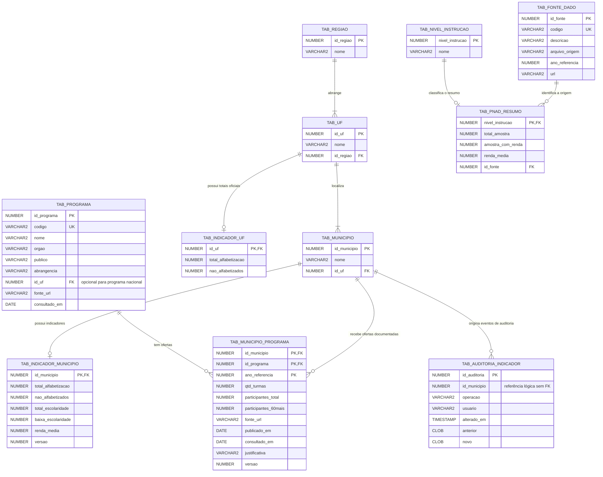

# MER e modelo relacional

Este documento descreve as 11 tabelas do esquema: três geográficas base e oito adicionais para indicadores, catálogos, programas, ofertas e auditoria.

## Modelo Entidade-Relacionamento (MER)

`TAB_PNAD_RESUMO` é um resumo nacional agregado por nível de instrução, ligado aos catálogos de níveis e fontes. `TAB_AUDITORIA_INDICADOR.id_municipio` não possui chave estrangeira intencionalmente, para preservar os registros de auditoria mesmo se o município relacionado for removido.

## Cardinalidades e regras

| Relacionamento | Cardinalidade | Regra implementada |
|---|---|---|
| Região — UF | 1:N | Cada UF referencia exatamente uma região; uma região possui uma ou mais UFs. |
| UF — Município | 1:N | Cada município referencia exatamente uma UF; uma UF pode ter vários municípios. |
| Município — Indicador municipal | 1:0..1 | Pode existir no máximo um registro de indicadores por município; a ausência do registro ou de valores é permitida. |
| UF — Indicador estadual | 1:0..1 | Pode existir no máximo um registro de totais oficiais por UF. |
| Programa — Oferta municipal | 1:0..N | Um programa pode ter ofertas em vários municípios e anos. |
| Município — Oferta municipal | 1:0..N | Um município pode registrar vários programas e anos. |
| Programa — Município | N:M, resolvido por `TAB_MUNICIPIO_PROGRAMA` | A chave da associativa é `(id_municipio, id_programa, ano_referencia)`, portanto há uma ocorrência por município, programa e ano. |
| Município — Auditoria | 1:0..N lógica | Eventos guardam o código do município, sem FK física para manter o histórico. |
| Nível de instrução — Resumo PNAD | 1:0..1 | Cada nível tem no máximo um resumo; todo resumo exige um nível cadastrado. |
| Fonte — Resumo PNAD | 1:0..N | Uma fonte pode ser usada por vários níveis; todo resumo exige uma fonte cadastrada. |

Os símbolos Mermaid `||`, `|{`, `o|` e `o{` indicam respectivamente “um obrigatório”, “um ou mais”, “zero ou um” e “zero ou muitos”.

## Modelo relacional

### Tabelas base

- **TAB_REGIAO** (`id_regiao` PK, `nome`)
- **TAB_UF** (`id_uf` PK, `nome`, `id_regiao` FK → `TAB_REGIAO.id_regiao`)
- **TAB_MUNICIPIO** (`id_municipio` PK, `nome`, `id_uf` FK → `TAB_UF.id_uf`)

### Tabelas adicionais

- **TAB_INDICADOR_MUNICIPIO** (`id_municipio` PK e FK → `TAB_MUNICIPIO.id_municipio`, `total_alfabetizacao`, `nao_alfabetizados`, `total_escolaridade`, `baixa_escolaridade`, `renda_media`, `versao`)
- **TAB_PNAD_RESUMO** (`nivel_instrucao` PK/FK → `TAB_NIVEL_INSTRUCAO.nivel_instrucao`, `total_amostra`, `amostra_com_renda`, `renda_media`, `id_fonte` FK → `TAB_FONTE_DADO.id_fonte`)
- **TAB_NIVEL_INSTRUCAO** (`nivel_instrucao` PK, `nome`)
- **TAB_FONTE_DADO** (`id_fonte` PK, `codigo` UNIQUE, `descricao`, `arquivo_origem`, `ano_referencia`, `url`)
- **TAB_INDICADOR_UF** (`id_uf` PK e FK → `TAB_UF.id_uf`, `total_alfabetizacao`, `nao_alfabetizados`)
- **TAB_PROGRAMA** (`id_programa` PK, `codigo` UNIQUE, `nome`, `orgao`, `publico`, `abrangencia`, `id_uf` FK opcional → `TAB_UF.id_uf`, `fonte_url`, `consultado_em`)
- **TAB_MUNICIPIO_PROGRAMA** (`id_municipio` PK e FK → `TAB_MUNICIPIO.id_municipio`, `id_programa` PK e FK → `TAB_PROGRAMA.id_programa`, `ano_referencia` PK, `qtd_turmas`, `participantes_total`, `participantes_60mais`, `fonte_url`, `publicado_em`, `consultado_em`, `justificativa`, `versao`)
- **TAB_AUDITORIA_INDICADOR** (`id_auditoria` PK, `id_municipio` sem FK, `operacao`, `usuario`, `alterado_em`, `anterior`, `novo`)

## Integridade referencial

As FKs geográficas ligam região → UF → município. Os indicadores usam relacionamento um-para-um opcional com sua unidade geográfica, implementado por PK compartilhada. A tabela associativa conecta programa e município e inclui o ano na chave para manter ofertas anuais separadas. As regras adicionais de abrangência estadual, versões e auditoria são aplicadas pelas constraints, procedures e triggers descritas em [`DICIONARIO_DADOS.md`](DICIONARIO_DADOS.md).
