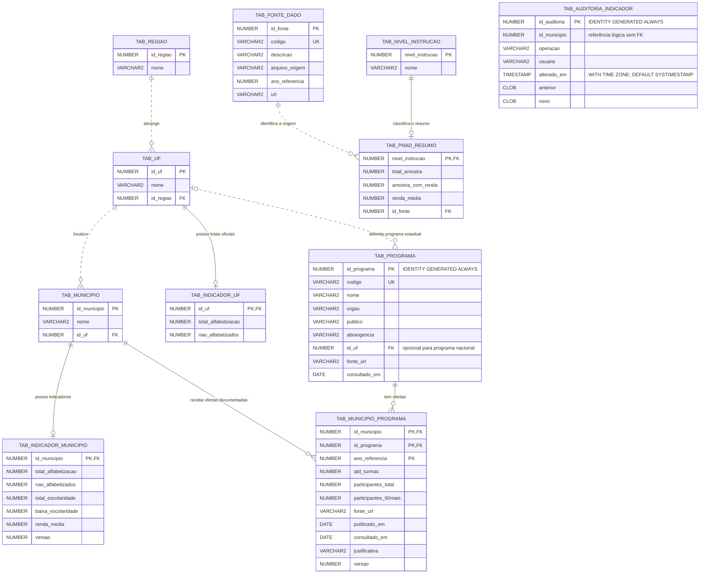
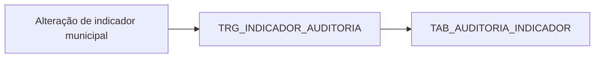

# MER e modelo relacional

Este documento descreve as 11 tabelas do esquema: três geográficas base e oito adicionais para indicadores, catálogos, programas, ofertas e auditoria.

**Versão editável:** [abrir/baixar o diagrama .drawio](diagramas/MODELAGEM_MER.drawio). Abra esse arquivo no diagrams.net para editar caixas e conexões ou exportar como imagem/PDF. Ele contém duas páginas: o MER com as nove FKs físicas e o fluxo lógico da auditoria. Se alterar o esquema, atualize o Markdown e o arquivo `.drawio` juntos.

Conferido em **24/11/2026** com as tabelas, colunas e constraints instaladas no Oracle, por consultas de leitura a `USER_TABLES`, `USER_TAB_COLUMNS`, `USER_CONSTRAINTS` e `USER_CONS_COLUMNS`. Os scripts de referência são `01_estrutura.sql`, `13_estrutura_programas.sql` e `13a_catalogos_pnad.sql`.

## Modelo Entidade-Relacionamento (MER)

### Resumo das relações em texto

Este resumo pode ser lido mesmo quando o visualizador não desenha o diagrama Mermaid. As setas mostram a tabela referenciada e a tabela que contém a FK.

```text
TAB_REGIAO (1) ───────────→ (0..N) TAB_UF
TAB_UF (1) ───────────────→ (0..N) TAB_MUNICIPIO
TAB_UF (1) ───────────────→ (0..1) TAB_INDICADOR_UF
TAB_UF (0..1) ────────────→ (0..N) TAB_PROGRAMA
TAB_MUNICIPIO (1) ────────→ (0..1) TAB_INDICADOR_MUNICIPIO
TAB_MUNICIPIO (1) ────────→ (0..N) TAB_MUNICIPIO_PROGRAMA
TAB_PROGRAMA (1) ─────────→ (0..N) TAB_MUNICIPIO_PROGRAMA
TAB_NIVEL_INSTRUCAO (1) ──→ (0..1) TAB_PNAD_RESUMO
TAB_FONTE_DADO (1) ───────→ (0..N) TAB_PNAD_RESUMO

TAB_AUDITORIA_INDICADOR: sem FK; preenchida pelo trigger de auditoria.
```

Em UF–Programa, um programa nacional não referencia UF; um estadual exige exatamente uma. A associação município–programa é N:M e inclui o ano na chave. A referência lógica da auditoria não aparece entre as nove FKs acima.

### Diagrama completo



`TAB_PNAD_RESUMO` é um resumo nacional agregado por nível de instrução, ligado aos catálogos de níveis e fontes. `TAB_AUDITORIA_INDICADOR.id_municipio` não possui chave estrangeira intencionalmente, para preservar os registros de auditoria mesmo se o município relacionado for removido.

As linhas do MER acima representam **somente as nove FKs físicas**. Por isso, a auditoria aparece sem ligação: ela pode guardar o código de um município que já foi excluído. O fluxo lógico da auditoria está separado abaixo.



O trigger grava o código municipal e os valores anteriores/novos. Esse fluxo não cria uma FK nem obriga o município a continuar existindo.

## Cardinalidades e regras

| Relacionamento | Cardinalidade | Regra implementada |
|---|---|---|
| Região — UF | 1:0..N | Cada UF exige uma região existente. O esquema permite uma região sem UFs cadastradas. |
| UF — Município | 1:0..N | Cada município exige uma UF existente. O esquema permite uma UF sem municípios cadastrados. |
| UF — Programa | 0..1:0..N | Cada programa referencia zero ou uma UF; cada UF pode ser referenciada por vários programas. A abrangência determina a obrigatoriedade descrita abaixo. |
| Município — Indicador municipal | 1:0..1 | Pode existir no máximo um registro de indicadores por município; a ausência do registro ou de valores é permitida. |
| UF — Indicador estadual | 1:0..1 | Pode existir no máximo um registro de totais oficiais por UF. |
| Programa — Oferta municipal | 1:0..N | Um programa pode ter ofertas em vários municípios e anos. |
| Município — Oferta municipal | 1:0..N | Um município pode registrar vários programas e anos. |
| Programa — Município | N:M, resolvido por `TAB_MUNICIPIO_PROGRAMA` | A chave da associativa é `(id_municipio, id_programa, ano_referencia)`, portanto há uma ocorrência por município, programa e ano. |
| Código municipal — Auditoria | Referência lógica, sem FK | Pode haver vários eventos para o mesmo código, inclusive quando já não existe município correspondente. Não impõe integridade referencial. |
| Nível de instrução — Resumo PNAD | 1:0..1 | Cada nível tem no máximo um resumo; todo resumo exige um nível cadastrado. |
| Fonte — Resumo PNAD | 1:0..N | Uma fonte pode ser usada por vários níveis; todo resumo exige uma fonte cadastrada. |

Os símbolos Mermaid `||`, `o|` e `o{` indicam respectivamente “exatamente um”, “zero ou um” e “zero ou muitos”. A linha contínua (`--`) indica relacionamento identificador: a FK também compõe a PK do filho. A linha pontilhada (`..`) indica relacionamento não identificador: a FK não compõe a PK do filho. **Ambas representam FKs**; uma linha pontilhada no MER não significa ausência de FK.

As cardinalidades representam o que as constraints permitem, não a quantidade de registros da carga atual. Por exemplo, todas as UFs carregadas podem ter municípios, mas a FK não exige que toda UF tenha ao menos um filho.

### Regra de abrangência dos programas

- Programa `NACIONAL`: `id_uf` deve ser NULL.
- Programa `ESTADUAL`: `id_uf` é obrigatório e deve referenciar uma UF existente.
- Uma oferta estadual deve pertencer a um município da mesma UF do programa, conforme `TRG_OFERTA_VALIDACAO`.
- Uma oferta nacional também precisa apontar para um município existente. A ausência de UF no programa não torna o município da oferta opcional.

## Modelo relacional

### Tabelas base

- **TAB_REGIAO** (`id_regiao` PK, `nome`)
- **TAB_UF** (`id_uf` PK, `nome`, `id_regiao` FK → `TAB_REGIAO.id_regiao`)
- **TAB_MUNICIPIO** (`id_municipio` PK, `nome`, `id_uf` FK → `TAB_UF.id_uf`)

### Tabelas adicionais

- **TAB_INDICADOR_MUNICIPIO** (`id_municipio` PK e FK → `TAB_MUNICIPIO.id_municipio`, `total_alfabetizacao`, `nao_alfabetizados`, `total_escolaridade`, `baixa_escolaridade`, `renda_media`, `versao`)
- **TAB_PNAD_RESUMO** (`nivel_instrucao` PK/FK → `TAB_NIVEL_INSTRUCAO.nivel_instrucao`, `total_amostra`, `amostra_com_renda`, `renda_media`, `id_fonte` FK → `TAB_FONTE_DADO.id_fonte`)
- **TAB_NIVEL_INSTRUCAO** (`nivel_instrucao` PK, `nome`)
- **TAB_FONTE_DADO** (`id_fonte` PK, `codigo` UNIQUE, `descricao`, `arquivo_origem`, `ano_referencia`, `url`)
- **TAB_INDICADOR_UF** (`id_uf` PK e FK → `TAB_UF.id_uf`, `total_alfabetizacao`, `nao_alfabetizados`)
- **TAB_PROGRAMA** (`id_programa` PK, `codigo` UNIQUE, `nome`, `orgao`, `publico`, `abrangencia`, `id_uf` FK opcional → `TAB_UF.id_uf`, `fonte_url`, `consultado_em`)
- **TAB_MUNICIPIO_PROGRAMA** (`id_municipio` PK e FK → `TAB_MUNICIPIO.id_municipio`, `id_programa` PK e FK → `TAB_PROGRAMA.id_programa`, `ano_referencia` PK, `qtd_turmas`, `participantes_total`, `participantes_60mais`, `fonte_url`, `publicado_em`, `consultado_em`, `justificativa`, `versao`)
- **TAB_AUDITORIA_INDICADOR** (`id_auditoria` PK, `id_municipio` sem FK, `operacao`, `usuario`, `alterado_em`, `anterior`, `novo`)

## Integridade referencial

As FKs geográficas ligam região → UF → município. Os indicadores usam relacionamento um-para-um opcional com sua unidade geográfica, implementado por PK compartilhada. A tabela associativa conecta programa e município e inclui o ano na chave para manter ofertas anuais separadas. As regras adicionais de abrangência estadual, versões e auditoria são aplicadas pelas constraints, procedures e triggers descritas em [`DICIONARIO_DADOS.md`](DICIONARIO_DADOS.md).

As nove FKs estão habilitadas no banco consultado. Nenhuma foi declarada com `ON DELETE CASCADE`: quando existe filho referenciando o registro, sua exclusão é bloqueada pela FK. A tabela de auditoria é uma exceção intencional por não possuir FK para município ou indicador.

## Campos obrigatórios, valores padrão e tipos

Todas as colunas de PK são obrigatórias. Além delas, os campos obrigatórios e opcionais são os seguintes, conforme o esquema instalado:

| Tabela | Obrigatórios além da PK | Aceitam NULL |
|---|---|---|
| `TAB_REGIAO` | `nome` | Nenhum |
| `TAB_UF` | `nome`, `id_regiao` | Nenhum |
| `TAB_MUNICIPIO` | `nome`, `id_uf` | Nenhum |
| `TAB_INDICADOR_MUNICIPIO` | `versao` | As cinco colunas de contagens/renda |
| `TAB_INDICADOR_UF` | `total_alfabetizacao`, `nao_alfabetizados` | Nenhum |
| `TAB_PNAD_RESUMO` | `total_amostra`, `amostra_com_renda`, `id_fonte` | `renda_media` |
| `TAB_NIVEL_INSTRUCAO` | `nome` | Nenhum |
| `TAB_FONTE_DADO` | `codigo`, `descricao`, `arquivo_origem` | `ano_referencia`, `url` |
| `TAB_PROGRAMA` | `codigo`, `nome`, `orgao`, `publico`, `abrangencia`, `fonte_url`, `consultado_em` | `id_uf`, somente para abrangência nacional |
| `TAB_MUNICIPIO_PROGRAMA` | `fonte_url`, `publicado_em`, `consultado_em`, `justificativa`, `versao` | `qtd_turmas`, `participantes_total`, `participantes_60mais` |
| `TAB_AUDITORIA_INDICADOR` | `id_municipio`, `operacao`, `usuario`, `alterado_em` | `anterior`, `novo` |

- `TAB_PROGRAMA.id_programa` e `TAB_AUDITORIA_INDICADOR.id_auditoria` são gerados pelo Oracle (`GENERATED ALWAYS AS IDENTITY`).
- As colunas `versao` têm valor padrão 1; os triggers controlam os incrementos.
- `TAB_PNAD_RESUMO.id_fonte` tem valor padrão 1 e FK obrigatória. O nome do nível não é único no catálogo; somente seu código é PK.
- As únicas constraints `UNIQUE` adicionais às PKs são `TAB_PROGRAMA.codigo` e `TAB_FONTE_DADO.codigo`.
- O MER usa tipos resumidos. Rendas são `NUMBER(12,2)`; contagens municipais/estaduais são `NUMBER(12)`; os IDs geográficos são `NUMBER(10)`. A chave numérica da associativa foi declarada como `NUMBER`, sem precisão explícita.
- `alterado_em` é `TIMESTAMP(6) WITH TIME ZONE`, obrigatório, com padrão `SYSTIMESTAMP`. `anterior` e `novo` são `CLOB` com validação JSON.

## Normalização e limites do modelo

Os nomes geográficos ficam em suas tabelas; indicadores usam chaves geográficas; os nomes dos níveis de instrução e a origem PNAD ficam nos catálogos. A tabela associativa evita criar colunas repetidas para cada programa de um município e sua chave composta distingue os anos.

O resumo PNAD permite somente uma linha por nível de instrução: sua PK não inclui ano nem fonte. Ele representa a amostra atual do projeto, não uma série histórica. A auditoria guarda instantâneos JSON intencionalmente; ela não substitui as tabelas de indicadores nem mantém histórico completo das ofertas de programas.

## View materializada e perfis

A estrutura possui 11 tabelas de negocio e a MV `MV_RESUMO_UF`, com armazenamento interno adicional. A MV e um resultado agregado por regiao/UF, nao uma nova entidade com FKs. Sua atualizacao e manual. Roles e usuarios sao objetos de seguranca e nao alteram os relacionamentos do MER. Consulte [SEGURANCA.md](SEGURANCA.md).
